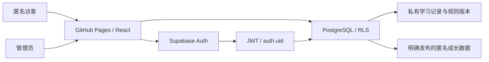

# 架构与数据权限

浏览器负责展示和录入，Supabase Auth 负责身份认证，PostgreSQL 负责授权、持久化和最终结算。静态托管的 GitHub Pages 不持有管理员密码或高权限密钥。

## 代码职责

`src/domain` 的 TypeScript 引擎不访问网络和浏览器存储。它负责周积分、考试得分率差、月度预测、规则选择、优秀连续次数和奖励阶梯，便于针对边界条件做单元测试。

`src/lib/supabase.ts` 验证前端公开配置后创建客户端。`src/lib/store.tsx` 管理认证状态、数据库角色核验、数据加载和写入。公开模式只加载已发布匿名数据及当前公开规则；管理员模式加载业务数据。演示模式使用独立内存数据，退出或刷新后不保留演示修改。

关键写入流程由数据库再次验证。`settle_month` 执行权威月度结算、快照保存及奖励发放；`use_reward` 锁定相关数据并校验余额；`adjust_reward` 记录有必填原因的人工补发或纠正，扣减不能超过余额；`publish_month` 仅从结算生成允许公开的匿名字段。客户端预测方便录入，客户端提交的计算结果不作为数据库的授权或最终结算依据。

## 数据结构

| 表 | 用途 | 匿名访问 |
| --- | --- | --- |
| `admin_roles` | 数据库管理员授权，与 Auth 用户关联 | 禁止 |
| `students` | 学生姓名与年级 | 禁止 |
| `rule_versions` | 不可变规则 JSON、版本号、生效日期 | 禁止直接读；仅通过公开规则函数读取允许公开的规则 |
| `weekly_records` | 四项分数、细则选择、知识点、薄弱点、反馈和规则引用 | 禁止 |
| `exams` | 原始成绩、考试满分、对比考试与可比性 | 禁止 |
| `monthly_settlements` | 月度结算、完整快照、修订信息 | 禁止 |
| `settlement_revisions` | 重新结算前的旧快照、原因与操作者 | 禁止 |
| `reward_entries` | 获得 / 使用奖励流水 | 禁止 |
| `semester_reviews` | 学期区间、教师评价和学期大奖 | 禁止 |
| `public_growth` | 管理员发布的匿名月度摘要 | 仅 `published = true` 可读 |
| `audit_logs` | 规则及关键操作日志 | 禁止 |

初期支持一个学生和一个管理员。数据使用 UUID 与外键，允许增加学生；当前管理员共享全部学生的管理权限。扩展到多个互不相干的家庭时，必须加入管理归属并更新权限策略。

## 授权边界

所有业务表启用 RLS。`anon` 仅拥有明确的公开读取入口；`authenticated` 也不自动拥有管理员权限，策略调用数据库角色核验函数。管理员角色不从用户可编辑的 Auth metadata 中取得，角色表不可通过浏览器新增、修改或删除。

授权既包含对象级 GRANT，也包含行级策略。安全定义者函数在执行前验证管理员身份，固定 `search_path` 并限定可调用角色。审计日志由数据库写入，应用账号不能自行编辑历史日志。

前端只使用 `sb_publishable_` key。Supabase 登录 session 由官方客户端保持，这是认证信息；学习数据持久化在 PostgreSQL。浏览器的 UI、路由保护和状态检查用于体验，最终权限由数据库执行。[Supabase RLS 说明](https://supabase.com/docs/guides/database/postgres/row-level-security)

## 规则与快照

修改规则会创建新版本。周记录依据授课日期选择版本；月度评级、考试加分和奖励规则选用该自然月月初生效的版本。周记录保存其规则引用，旧结算保留完整配置，避免新权重改变旧结算。

结算快照包括有效条数、平均分、考试加分、综合分、计算评级、最终评级、调整理由、参与周记录 / 考试 ID 与规则配置，还保存当时的周记录、考试和对比考试完整输入。已结算月度趋势使用快照输入；周记录管理展示当前明细。后续编辑周记录或创建新规则不会隐式修改快照。重新结算是独立操作，有确认、必填原因、修订号和审计。

奖励流水记录当时的奖励名称、单位与数量。修改奖励名称不混淆以前的余额；非优秀月不会清除历史奖励。重复结算不能重复发放同一结算的奖励，已使用的奖励不被自动取消。补录历史月份或修改早期评级时，后续已发放流水不自动变化；管理员核对后通过带原因的调整流水纠正，而不是改写原流水。

公开数据是独立发布的摘要，而非对原始记录直接开放的视图。重新结算会自动撤回原来的公开摘要，应由管理员检查并主动重新发布；撤回后匿名用户不能再读取该条数据。

## 测试范围

单元测试覆盖完整精度、评级边界、考试可比性、缺失记录、连续优秀暂停、奖励和规则版本选择。SQL 测试在真实 PostgreSQL 引擎 PGlite 中模拟访客、普通已登录用户与管理员，验证迁移、RLS、约束、结算和奖励。

PGlite 使用模拟 `auth.users` 与 `auth.uid()`，不运行 Supabase Auth、HTTP 网关和邮件服务。因此，生产云端上线验收需要另外核对登录、API 权限、真实持久化和 Pages 路由。
